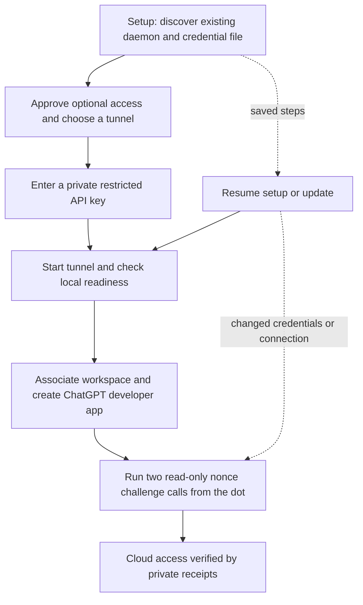

# Secure MCP Tunnel access from ChatGPT

An optional Secure MCP Tunnel connects a ChatGPT developer app to the same
Pseudolife daemon your local clients use. Guided setup saves private progress,
checks the existing MCP shim without starting a daemon, and keeps local client
and plugin registrations unchanged. Browser steps need your own account choices;
local readiness alone does not prove that your dot can access memory.



**With the native client**, `tunnel setup` can save a profile using an
explicit `--daemon-url` and owner-only `--token-file` after `--accept-access`
and an authenticated daemon check. Resume the prepared profile with
`--tunnel-id`, then import its first runtime key in a separate setup command
using `--read-key` at a terminal or an owner-only `--key-file`. Use
`pseudolife-mcp tunnel run` to keep a prepared tunnel in the foreground.
On first launch it installs the pinned tunnel-client program automatically
and checks the downloaded archive against its expected checksum.
In another terminal, `pseudolife-mcp tunnel stop` asks that native
supervisor to stop its runtime. Pass the same `--profile` and
`--profile-dir` in both commands if you selected a different profile or
store. Use the same client to manage a running tunnel. The Python client's
status can report a native launch as stopped, and Python stop leaves that
launch running. The native client has no background start: keep `tunnel run`
open in a terminal, and end it with `tunnel stop`.

To renew a key with the native client, stop the tunnel, then run
`pseudolife-mcp tunnel setup --profile dot --read-key --key-expires-at <ISO timestamp>`
with your profile name and the new key's expiry. You can supply the replacement
through an owner-only `--key-file`. Omit the expiry if the new key has no known
deadline. If setup reports an interrupted renewal, rerun `tunnel setup` for
the same profile and directory before starting the tunnel again. Check the
saved expiry with `tunnel status`, then use `tunnel run`.
The native client retains the previous private key and expiry until the
replacement completes a control-plane poll. If the trial fails, stop the
tunnel and run `pseudolife-mcp tunnel setup --restore-key` with the same
profile and directory. Use `--discard-previous-key` only after the
replacement has worked. After accepting the replacement, revoke the
previous key at the provider.

The native client answers `tunnel status` for a profile it
can load, reading the tunnel's process record to say whether the tunnel
runs. `tunnel update` reports a tunnel that is not running, and names a
process record left by a stopped tunnel as a file you can delete (a
`leftover` when no saved profile is beside it). It reports `current` for
a ready native launch whose identity matches the client running the check and
the saved settings. After an installed client update, a compatible native
supervisor verifies and pins the installed shim and checks its readiness
protocol and saved daemon connection while the current tunnel serves. It
then stops its owned vendor process, confirms exit, and starts the new
launch. As with a plain `tunnel run`, readiness requires the vendor to
remain alive, answer its local readiness probe, and have a bridge that
accepted the signed launch and started the stdio shim. This reconnects the
tunnel and interrupts its current session. A refused preflight leaves the
previous tunnel serving.

If the candidate fails readiness, the supervisor tries the previous shim
after confirming the replacement exited. A successful rollback can mean a
second reconnect and preserves verification for the previous identity.
Further updates skip that failed build for the same launch. After a readiness
timeout, stop and run the tunnel to retry that build. After a startup failure
or vendor diagnostic, keep serving on the previous runtime until a corrected
runtime is installed, then run `tunnel update`. If rollback fails, status
says the tunnel stopped and gives the run command. If the
supervisor cannot confirm a child's exit, it blocks recovery until exit
can be established. Status also shows when a refreshed launch needs a new
verification challenge.

`tunnel update` exits 0 for a current or refreshed launch and for a refusal
or rollback that leaves the previous tunnel serving. It exits 2 if the
store is unreadable, the tunnel stops during refresh, or the supervisor cannot
confirm a child's exit or disappears before reporting the result. The outer
`pseudolife-mcp update` reports this failure with exit 5.

An older native foreground supervisor needs a one-time `pseudolife-mcp tunnel stop`
followed by `pseudolife-mcp tunnel run` for the same profile and directory.
Use the same commands when the updated client pins a different vendor version.
If a service or scheduled task started that supervisor, restart the existing
registration through its manager.

A Python-supervised tunnel keeps serving after the client switch.
For a planned switch, stop it with the Python client before changing clients.
After switching, run `pseudolife-mcp tunnel stop --profile <name>`. It prints
a copyable stop command when it can read the saved profile and locate the
retained Python client. The `tunnel update` JSON report puts the same guidance
in its `detail` field. If you cannot stop the Python tunnel, wait until its
process ends, for example after a restart.
Once `tunnel status` reports the tunnel has stopped, move aside any leftover
process record it names. If the saved profile is missing, use `tunnel
update` to check for an orphaned process record and move it aside only when
the report marks it `leftover`. Restore or recreate the profile before
starting the tunnel. Run `pseudolife-mcp tunnel run --profile <name>` in a
terminal you keep open. Include the same `--profile-dir` if you use a custom
directory.

An interrupted key renewal or a retained previous key reports `stale` with
guidance for that state. A pending refresh request written by the Python
client does not affect the native launch check.
A record it cannot judge (unreadable, or naming no
process id) is reported as unknown and never called deletable, and a saved
profile it cannot read is named as `unread` with the reason, naming the field where one is at fault. The native
client also answers preflight refusals for `tunnel verify` and `tunnel setup`.
Anything else it does not run is refused with one line naming the cause
and what to run instead (exit 2), having changed nothing. `start`,
`doctor`, `service`, `setup --start` and `setup --open-browser` are not part of
the native client; the refusal names `tunnel run` in a terminal you keep open
(ended with `tunnel stop`), `tunnel status`, or the Platform pages. Guided setup is not either: the
refusal names the explicit `--daemon-url` and `--token-file` to use. A file
it cannot read (a profile, key, verification challenge or refresh file in a
form it does not read) is named with the fix, as are verification of a launch
another client started and a Windows (DPAPI) key it cannot unseal in this
session. Settings edits keep a saved key and approved autostart; a process
record refuses them, naming the record. On Windows it unseals
the saved key to check it: a damaged key file is no usable key, and a key
sealed by another account, or read over a logon without the account's
credentials (such as a key-based SSH logon), is reported as `not_verified`.
`pseudolife-mcp doctor` lists saved tunnels and names only steps this client
runs. The native client does not register or start a tunnel service. A
machine whose tunnel the Python client registered to start by itself stays on
the Python client: an update keeps it unless you opt in with
`PSEUDOLIFE_SHIM_ENGINE=native`. A native `update` there leaves the running
tunnel as it is and says so in its tunnel line (see
[The native client](configuration.md#the-native-client), which also says how
to go back). A machine whose tunnel is set to start by itself stays on the
Python client (see [Autostart and private storage](#autostart-and-private-storage)).

## Start or resume

Use an always-on host if you need access while a laptop sleeps. Both its daemon
and tunnel must remain running. With the Python client, install Pseudolife
normally, then start guided setup:

```sh
pseudolife-mcp tunnel setup
```

With the Python client, the installer can enter this guided flow with
`ops/install.sh --tunnel` or `ops/install.ps1 -Tunnel`. The native installer
refuses that switch before changing the host. For the native client, rerun
without the switch and follow the explicit profile and key setup above.
Guided setup reuses saved choices and does not ask again for access consent
or a saved key.
If discovery finds conflicting registrations or only a literal token, select the
connection explicitly using an existing owner-only token file:

```sh
pseudolife-mcp tunnel setup --daemon-url http://127.0.0.1:8765 --token-file <private-token-file> --accept-access
```

`--accept-access` records your consent to this access path. It does not create
accounts, API keys, workspace associations or apps. On a shell without a terminal,
pass it explicitly. A profile is named `dot` by default; `--profile <name>` keeps
separate connections. `--profile-dir <directory>` selects private profile storage.

## Complete the account steps

1. Open [Platform tunnel settings](https://platform.openai.com/settings/organization/tunnels).
   Check the selected organization, create or choose a tunnel, then copy its ID.
   Resume with `pseudolife-mcp tunnel setup --tunnel-id <tunnel_id>`; supply
   `--organization-id <organization_id>` when needed.
2. In that organization's [API key settings](https://platform.openai.com/settings/organization/api-keys),
   create a **Restricted** key with **Tunnels: Read + Use** for the running tunnel.
   Creating or editing a tunnel separately needs **Read + Manage**. Enter the
   runtime key privately with `pseudolife-mcp tunnel setup --read-key`, or use
   `--key-file <owner-only-file>`. Keep it out of chat, command arguments and
   environment variables. If its expiry is known, save it with
   `pseudolife-mcp tunnel setup --key-expires-at 2026-12-01T00:00:00Z`.
   The native client requires a separate call to save the expiry before
   importing the first key. The Python client accepts expiry and key input
   in one command. A date such as `2026-12-01` means midnight UTC. Give full
   timestamps a timezone. Without an expiry, status reports it as unknown.
3. With the native client, use `pseudolife-mcp tunnel run` in a foreground
   terminal. With the Python client, use `tunnel start` for a managed launch
   or `tunnel run` in the foreground. The Python client's `tunnel setup --start`
   resumes setup and starts the managed process. Its `tunnel doctor` checks
   the local MCP connection and vendor runtime.
4. In the intended ChatGPT workspace, open [developer apps](https://chatgpt.com/plugins),
   enable developer mode where available, create a developer app, choose
   **Connection: Tunnel**, and select this tunnel. Review the workspace
   association separately from the Platform organization and app creation.
   Availability and access follow those account/workspace settings.

With the Python client only, `setup --open-browser tunnels`, `keys`, or `app` opens the selected step without
inventing an OAuth or device-code flow. Use the commands printed by setup to resume.
The local profile and key survive interrupted browser work.

## Prove access through the cloud

Run `pseudolife-mcp tunnel verify` after connecting the developer app, then paste
its exact prompt into your dot with that app enabled. It asks for `memory_search`
and `memory_agents(action="list")`, using a fresh nonce as the query and project
filter. Empty search results and zero matching peers are fine: these calls verify
the path without writing memory or changing the board. Optionally ask one cloud
child to repeat the prompt; no model API spending is launched by the CLI.

```sh
pseudolife-mcp tunnel status
```

Only successful real responses to both challenge calls establish cloud verification.
The tunnel forwards the installed shim's MCP traffic and saves private receipts
containing tool names, success flags and timestamps, never memory or board contents.
Receipts match the actual ready launch, its saved profile, connection, key and
challenge. After changing a key, daemon, tunnel, organization or catalog,
restart a foreground launch with `tunnel stop` and `tunnel run` before issuing
a new challenge. Use `tunnel setup --start` for a Python-managed background
launch. `tunnel status` reports the active launch's verification. With the
Python client, `tunnel doctor --json` also reports the local checks.

## Discovery, updates and renewal

The default catalog is the daemon's current discovery tier. Choose
`tunnel setup --catalog full` explicitly to keep full tool discovery available
after a daemon restart or tier expiry. This expands discovery for the reused
daemon principal, including its other sessions; it does not change authentication
permissions or create a dedicated principal. Each tools/list request rechecks full
discovery and restores it when needed, then reports an error if it cannot do so.

With the Python client, `pseudolife-mcp update` (and `ops/update_clients.py`
from a checkout) refreshes
running saved tunnels after it installs the new shim runtime, by running
`tunnel update` through the installed launcher. A refresh freezes the bridge and
packages of the process that runs it, so this moves running tunnels onto the
release just installed and never onto a checkout's code. Without an installed
launcher (pip or lite installs) the step is skipped and names
`pseudolife-mcp tunnel update`; when the shim step fails it is skipped and names
the launcher command to run once the shim is fixed. The refresh runs without
`PYTHON*` environment variables, so an exported `PYTHONPATH` cannot reach the
bridge; a refresh that times out is reported as timed out, with the command to
run again after `tunnel status`. Removing old shim runtimes keeps any runtime a
running tunnel's bridge still imports from while that tunnel's processes are
alive, and removes nothing when saved tunnel records cannot be read.
The Python client's `pseudolife-mcp tunnel update` updates only saved tunnels. Running managed tunnels
refresh their bridge and shim, even when the vendor version stays the same, and
must become locally ready before the update succeeds. A failed candidate attempts
to restore the previous immutable bridge/shim snapshot and readiness; a successful
rollback preserves availability but still reports a failed update needing attention.
Status shows this last refresh outcome separately from current runtime readiness.
Cloud proof binds to the active snapshot: a successful source refresh needs a new
challenge, while restoration of the same identity preserves existing proof files.

Older running records without a safe snapshot are refused unchanged; with the
Python client, use an explicit `tunnel stop` then `tunnel start` to adopt the
managed refresh path. Rollback freezes
the bridge and stdio shim files plus their launcher, while shared helpers and
dependencies retain their installed versions. Changes to those shared components
can therefore require further repair or fresh cloud verification after rollback.
Idle profiles remain idle and no saved profile means no implicit new setup. The
supported upstream runtime stays checksum-pinned; updates do not choose upstream
latest or change profiles, keys, autostart consent or local client registrations.

Renew with `tunnel setup --read-key --key-expires-at <ISO-timestamp>`. A replacement
key is staged through local configuration checks before replacing the saved key;
a rejected candidate leaves the existing key and profile intact. These checks do
not prove cloud identity. With the Python client, use `tunnel setup --start` to adopt the saved replacement
in a ready managed launch, then repeat `tunnel verify`. Failed refreshes restore
the previous launch; cloud proof is valid only when the saved selection agrees
with the actual restored configuration and credentials.
Correcting only the recorded expiry preserves cloud proof and does not require a
restart; the CLI still checks that expiry before starting a tunnel.

## Autostart and private storage

`tunnel service` is the Python client's: the native client has none. With the
Python client, `tunnel service preview` shows the host service definition. Install it only after
reviewing it with `tunnel service install --accept-autostart`. Use
`tunnel service status`, `stop` or `remove` to manage the owned service;
`tunnel stop` stops an owned managed tunnel process. A tunnel stopped that way
ends its supervisor successfully, so its service does not restart it; the
service starts it again at the next login or boot. A runtime that exits by
itself still counts as a failure, and the service restarts it.
Each install needs this explicit consent; saved consent does not authorize a new
installation. `--persistent` remains an equivalent compatibility option.

Windows and macOS services depend on the user's login session. A Linux user
service also normally depends on login; `--linger` explicitly opts into running
that user service while logged out. This may require host authorization. A root
Linux/LXC install instead needs the explicit `--system-service` choice on service
commands; it uses the existing root privilege and should be reviewed as such.
It installs, and a root tunnel starts or refreshes, only when every path root
would run is owned by root and not writable by its group or others: the
launcher, the runtime it starts, the interpreter, the site-packages the bridge
imports from, the bridge interpreter's own import path and user site, the `.pth`
files in those site directories (they run at interpreter start), the package,
the tunnel profile directory, and each of their parent directories up to `/`.
Otherwise it refuses and names the path; install Pseudolife as root, or fix that
path's owner and mode, then retry. A group-writable
`/usr/local/lib/python3.X/dist-packages` (Debian's historical root:staff 2775)
is refused this way.
No root service or login policy is changed implicitly. An autostart service cannot keep
a sleeping or powered-off host available.

**A machine with an autostart service stays on the Python client.** The
service starts the tunnel through the installed `pseudolife-mcp` launcher,
and the native client supports foreground operation through
`pseudolife-mcp tunnel run`. A run that would
move this machine to the native client refuses while an installer-owned
tunnel service is registered and runs that launcher, including a disabled
service. An update with
`PSEUDOLIFE_SHIM_ENGINE=native` exits 2, and the installer with it stops in
its preflight; `runtime install --check` is the check both use. The refusal
names the service and changes nothing. Rerun with
`PSEUDOLIFE_SHIM_ENGINE=python` in place of any `PSEUDOLIFE_SHIM_ENGINE=native`
to stay on the Python client. To move anyway, first remove the autostart,
then rerun. The refusal prints the service manager's own commands for that,
which need no Python client:
- `systemctl disable --now`, then delete the unit file and run
  `daemon-reload`;
- or `launchctl bootout`, then delete the plist;
- or `schtasks /End` and then `schtasks /Delete`, even when `/End` says
  the task is not running.

On Linux and macOS, also delete the Python client's record of the service
(`pseudolife-tunnel-<profile>.service-owner` in the profile directory). The
refusal names it. A record left behind makes that client's later `tunnel
service` commands refuse the profile. The refusal also prints the Python
client's `pseudolife-mcp tunnel service remove` command, which does all of
this itself. It carries the service's `--profile`, `--profile-dir` and, for
a root service, `--system-service`.

Removing autostart means the tunnel will no longer start on its own. An
unattended update on the daemon's host that was configured to opt in
instead updates the daemon alone and says why. Once the autostart is gone,
move the client with
`PSEUDOLIFE_SHIM_ENGINE=native pseudolife-mcp update --clients-only`.

A saved profile without a service, or a service that runs another program,
does not block the move. A service you made by hand (no owner marker, but its
command is the launcher followed by `tunnel run`) is named in a warning and
never blocks the move. The warning gives the command that disables it
(`systemctl --user disable --now`, `launchctl bootout` and `launchctl
disable`, or `schtasks /Change /Disable`); deleting what you wrote is left to
you. The move then goes ahead, and [The native
client](configuration.md#the-native-client) says how to go back. These are
looked for:

- every `*.service` in `~/.config/systemd/user`, with `%h` expanded, and in
  `/etc/systemd/system` (as root, the product's own units there too),
  following a symbolic link to a unit you manage elsewhere;
- every `*.plist` in `~/Library/LaunchAgents` (`ProgramArguments`);
- every scheduled task, in one read-only `schtasks /Query /XML`, with
  `%VARIABLE%` in its command expanded.

Not recognised: drop-in files, `ExecStart` lines continued with `\`, a
program behind `sh -c`, `env`, `EnvironmentFile=` or `${VAR}`, the other unit
directories (`~/.local/share/systemd/user`, `/etc/systemd/user`), a binary
plist or one using only `Program`, a task that runs the launcher through
PowerShell or by bare name, and, on a Windows machine already on the native
client, any task when no profile was ever saved in `~/.pseudolife-mcp/tunnel`.

On a machine already on the native client, an update warns about a tunnel
service this product installed and prints the service manager's own
commands that remove it, since that client has no `tunnel service` command
(`systemctl --user disable --now` then deleting the unit, `launchctl bootout`
then deleting the plist, or `schtasks /Delete`).

Windows stores the runtime key using user-scoped DPAPI plus owner-only ACLs;
POSIX stores it in an owner-only file, with disk encryption left to the host.
Private launch files exist only while the supervisor owns the process. While a
tunnel runs, one of them holds the decrypted runtime key for the vendor runtime
to read, so DPAPI and other at-rest protection apply only while it is stopped.
The CLI passes file references, never the API key in command arguments or the
environment. Do not copy private profile storage into a repository or share
runtime logs.

The upstream [Secure MCP Tunnels runtime](https://developers.openai.com/api/docs/guides/secure-mcp-tunnels)
provides the account transport. Reusing it avoids a second custom tunnel protocol;
the small Pseudolife bridge adds resumable setup, discovery restoration and
payload-free verification while retaining the existing shim's authentication and
MCP behavior. It requires the upstream runtime and account features to remain
available, and browser account setup stays an explicit user step.
